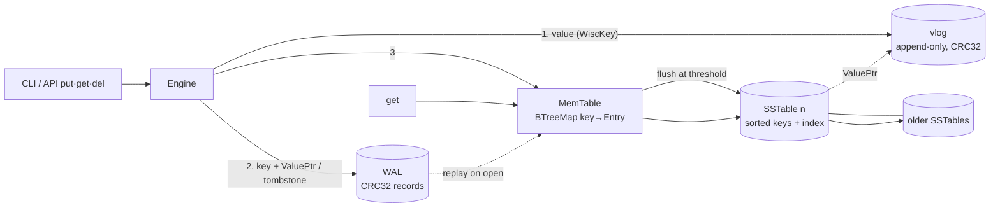

# WiscLite

**A Rust LSM-tree key-value store that separates keys from values, after the WiscKey paper (USENIX FAST '16).** It also has a baseline mode that stores values inline, so you can measure the difference yourself.


## The paper in one paragraph
LSM-trees such as LevelDB and RocksDB keep data in sorted files and keep rewriting those files as they merge (compact) them. Each rewrite copies **values** as well as keys, so a 1 KB value can be written to disk 10–50 times. That is *write amplification*, and it wears out SSDs and eats bandwidth. **WiscKey** (Lu et al.) appends values once to a separate **value log (vlog)** and keeps only `key → (offset, length)` pointers in the LSM-tree. The tree becomes tiny, so compaction moves far fewer bytes. The cost is an extra random read per lookup, which is cheap on SSDs, plus the need for vlog garbage collection.

## Architecture

| Module | File | What it does |
|---|---|---|
| `wal` | `src/wal.rs` | Append-only log of `crc32 \| len \| klen \| key \| entry`. Replayed on open; stops at the first torn or corrupt record. Reset after each flush. |
| `vlog` | `src/vlog.rs` | Append-only `crc32 \| len \| value`. Returns a `ValuePtr {offset, len}` and verifies the checksum on read. |
| `memtable` | `src/memtable.rs` | `BTreeMap<key, Entry>`, where an `Entry` is a `Ptr`, an `Inline` value or a `Tombstone`, with an approximate byte size. |
| `sstable` | `src/sstable.rs` | Immutable sorted file holding a data section, a full key index (CRC-protected) and a footer. The index is loaded on open, and `get` binary-searches it and does one disk read. Written to a temp file, then renamed atomically. |
| `engine` | `src/engine.rs` | put/get/delete, flushes at `memtable_bytes`, reads memtable → newest → oldest sstable, recovers via the WAL, and persists the `MODE` file. Counts every byte it writes. |

## Results (real run, `wisclite bench`)
50,000 random 16-byte keys with 1,024-byte random values per mode, a 4 MiB memtable, and no per-write fsync. Machine: Intel Xeon (cloud VM), Linux, release build.

| Metric | Baseline (inline) | WiscKey (separated) |
|---|---:|---:|
| Logical bytes | 52.2 MB | 52.2 MB |
| WAL bytes | 53.0 MB | 2.2 MB |
| Value log bytes | 0 | 51.6 MB |
| SSTable (LSM tree) bytes | 54.15 MB | **3.35 MB** |
| Physical bytes written | 107.2 MB | 57.2 MB |
| **Write amplification** | **2.055×** | **1.096×** |
| Tree amplification (sst/logical) | 1.038 | **0.064** (16× smaller) |
| Memtable flushes | 13 | 1 |
| Put throughput | 229k ops/s (239 MB/s) | 318k ops/s (331 MB/s) |
| Get p50 / p99 (10k random gets) | 2.9 / 11.2 µs | 2.7 / 5.9 µs |

WiscLite has no compaction yet, so the baseline's WA is only 2× (WAL plus one sstable write). With leveled compaction, the tree bytes get rewritten about *k* times. Using the measured bytes, the modelled WA at k = 10 is **11.4× for the baseline and 1.67× for WiscKey**; the dashboard plots this. Throughput and latency vary from run to run by about ±20% on this VM; the byte counts are deterministic.

## Run it
```bash
cargo test --release                      # 13 tests
cargo build --release
B=./target/release/wisclite
$B put hello world && $B get hello && $B del hello && $B get hello
$B --baseline --dir base-db put k v       # inline-value baseline store
$B stats
$B bench                                  # 50k x 1KB, both modes -> bench.json
$B bench --n 200000 --value-size 4096 --memtable 8388608
python3 -m http.server 8000               # open http://localhost:8000/metrics.html
```
`metrics.html` is a single file. It loads `bench.json` when served over HTTP, and otherwise falls back to the embedded copy of the last run.

## Tests
`cargo test` runs 13 tests. They cover entry encoding round-trips, memtable ordering, vlog checksums, put/get in both modes, newest-wins across flushes, tombstones shadowing older sstables (including after reopen), WAL crash recovery, a torn WAL tail, a corrupt WAL record, sstable ordering and binary search, auto-flush with 2,000 keys plus reopen, mode persistence, and WiscKey's tree being more than 10× smaller.

## Limitations (honest list)
- **No compaction and no vlog garbage collection.** SSTables only accumulate, so reads check every table, newest first, and overwritten values stay in the vlog for good.
- No Bloom filters and no range scans yet. Every key is in the in-memory index (no block index).
- Durability: writes are flushed to the OS on every put, but fsync happens only on flush, or on every write with `sync_writes: true`, which the CLI doesn't expose. A power cut can lose recent writes, though not a process crash.
- Single-threaded, with no concurrent readers or writers and no MVCC or snapshots.
- WAL and vlog are separate files. The paper's optimisation of using the vlog *as* the WAL isn't implemented, which costs 2.2 MB of extra WAL bytes here.
- Get latency is measured warm, from the OS page cache, on one VM. It is not an SSD benchmark.

## Roadmap
Leveled compaction with a measured WA, vlog GC (the paper's head/tail scheme), Bloom filters, block index, range scans with parallel vlog prefetch, vlog-as-WAL, and a YCSB-style comparison with `sled` or RocksDB.

## Citations
1. L. Lu, T. S. Pillai, A. C. Arpaci-Dusseau, R. H. Arpaci-Dusseau. *WiscKey: Separating Keys from Values in SSD-conscious Storage.* USENIX FAST 2016. https://www.usenix.org/system/files/conference/fast16/fast16-papers-lu.pdf
2. P. O'Neil, E. Cheng, D. Gawlick, E. O'Neil. *The Log-Structured Merge-Tree (LSM-Tree).* Acta Informatica, 1996.
3. A. Chi (skyzh). *mini-lsm: build a simple LSM-tree storage engine in Rust.* https://github.com/skyzh/mini-lsm
4. Vanilla-Beauty. *tiny-lsm.* https://github.com/Vanilla-Beauty/tiny-lsm

## License
Not chosen yet (Dee to pick, e.g. MIT).
