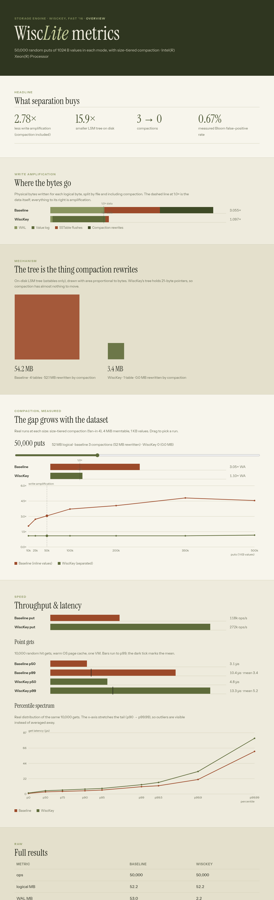
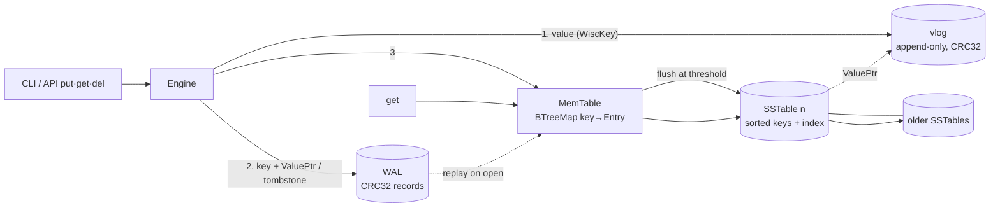

# WiscLite

[](https://deepanshu16125.github.io/WiscLite/) [](https://deepanshu16125.github.io/WiscLite/metrics.html) 

**A Rust LSM-tree key-value store that separates keys from values, after the WiscKey paper (USENIX FAST '16).** It also has a baseline mode that stores values inline, so you can measure the difference yourself.



## The paper in one paragraph
LSM-trees such as LevelDB and RocksDB keep data in sorted files and keep rewriting those files as they merge (compact) them. Each rewrite copies **values** as well as keys, so a 1 KB value can be written to disk 10–50 times. That is *write amplification*, and it wears out SSDs and eats bandwidth. **WiscKey** (Lu et al.) appends values once to a separate **value log (vlog)** and keeps only `key → (offset, length)` pointers in the LSM-tree. The tree becomes tiny, so compaction moves far fewer bytes. The cost is an extra random read per lookup, which is cheap on SSDs, plus the need for vlog garbage collection.

## Architecture

| Module | File | What it does |
|---|---|---|
| `wal` | `src/wal.rs` | Append-only log of `crc32 \| len \| klen \| key \| entry`. Replayed on open; stops at the first torn or corrupt record. Reset after each flush. |
| `vlog` | `src/vlog.rs` | Append-only `crc32 \| len \| value`. Returns a `ValuePtr {offset, len}` and verifies the checksum on read. GC writes a new generation (`vlog.N`). |
| `memtable` | `src/memtable.rs` | `BTreeMap<key, Entry>`, where an `Entry` is a `Ptr`, an `Inline` value or a `Tombstone`. Supports range iteration. |
| `sstable` | `src/sstable.rs` | Sorted file holding the data, a full key index, a **Bloom filter** (10 bits/key, 7 probes) and a CRC-protected footer. `get` checks the Bloom filter, then binary-searches. Also has `range` and `all`. |
| `bloom` | `src/bloom.rs` | Bloom filter using double hashing. The measured false-positive rate is reported in stats. |
| `engine` | `src/engine.rs` | put/get/delete/scan, flushes, **size-tiered compaction** (fan-in 4) that drops tombstones when it reaches the oldest table, **value-log GC**, and an atomic **MANIFEST** that is the commit point for flush, compaction and GC. Every byte written is counted. |
| `server` | `src/server.rs` | `wisclite serve`: a std-only localhost HTTP server for the dashboard plus a JSON API. |

## Results (real runs, `wisclite bench`)
Each run uses random 16-byte keys with 1,024-byte random values, a 4 MiB memtable, size-tiered compaction with fan-in 4, and no per-write fsync, on an Intel Xeon cloud VM (release build). Write amplification (WA) **now includes compaction bytes**.

**50,000 puts** (`bench.json`)

| Metric | Baseline (inline) | WiscKey (separated) |
|---|---:|---:|
| Logical bytes | 52.2 MB | 52.2 MB |
| WAL / vlog / flush / compaction | 53.0 / 0 / 54.2 / 52.1 MB | 2.2 / 51.6 / 3.4 / 0 MB |
| Physical bytes written | 159.3 MB | 57.2 MB |
| **Write amplification** | **3.06×** | **1.10×** |
| Tree amplification (flush+compaction) | 2.04 | 0.065 |
| Flushes / compactions / tables left | 13 / 3 / 4 | 1 / 0 / 1 |
| Put throughput | 135k ops/s | 259k ops/s |
| Get p50 / p99 (hit) | 2.4 / 8.1 µs | 4.5 / 21.0 µs |
| Get p50 (miss, Bloom) | 0.2 µs | 0.1 µs |
| Bloom FPR (measured) | 0.82% | 0.67% |
| Range scan, 3,266 rows | 3.3 ms | 11.4 ms |

**500,000 puts** (`docs/bench-500k.json`): the gap widens as the tree grows

| Metric | Baseline | WiscKey |
|---|---:|---:|
| Physical bytes written | 2,374 MB | 606 MB |
| **Write amplification** | **4.55×** | **1.16×** |
| Compaction bytes / compactions | 1,302 MB / 39 | 34 MB / 1 |
| Put throughput | 86k ops/s | 212k ops/s |
| Get p50 / p99 | 5.8 / 15.5 µs | 5.6 / 12.1 µs |
| Bloom FPR | 0.79% | 0.83% |
| Range scan, 31,275 rows | 50 ms | 89 ms |

**GC.** The bench overwrites 25% of keys and then runs GC. WiscKey reclaimed **13.8 MB of 68.8 MB** (50k run) and **137.5 MB of 688 MB** (500k run). In the baseline, compaction had already discarded most of the overwritten values (0.5 MB left to reclaim in the 50k run). That is exactly the paper's trade-off: the baseline pays for space reclamation with write amplification on every compaction, while WiscKey defers it to an explicit GC.

**Reading the numbers.** WiscKey wins on writes because compaction only moves 21-byte pointers. It is slower on range scans (one random vlog read per key, and I don't do the paper's parallel prefetch) and on hit-latency tails. Latency figures are page-cache warm and vary about ±20% between runs; the byte counts are deterministic.

## Website
- **Landing page:** https://deepanshu16125.github.io/WiscLite/ (`index.html` + `play.js`) has the hero, API, numbered write path, a "play a put" simulation (`?steps=N` fast-forwards it), measured KPIs, built vs not yet, and citations.
- **Dashboard:** https://deepanshu16125.github.io/WiscLite/metrics.html shows the WA stack with a 1.0× tick, area-true tree sizes, a measured compaction sweep slider (10k–500k puts), throughput, p50/p99/mean, and the real percentile spectrum.
- All design tokens (palette and fonts) live in one `:root` block in `site.css`. After a new bench, run `python3 scripts/embed_bench.py` to refresh the offline fallback copy.

## Run it
```bash
cargo test --release                      # 22 tests
cargo build --release
B=./target/release/wisclite
$B put hello world && $B get hello && $B del hello && $B get hello
$B scan a z --limit 20                    # keys in [a, z)
$B gc                                     # value-log GC, prints reclaimed bytes
$B compact                                # merge all sstables, drop tombstones
$B --baseline --dir base-db put k v       # inline-value baseline store
$B stats
$B bench                                  # 50k x 1KB, both modes -> bench.json
$B bench --n 500000 --out docs/bench-500k.json
$B serve --port 7878                      # http://127.0.0.1:7878/ site, dashboard + API
$B bench --sweep 10000,50000,200000       # sizes for the dashboard's compaction slider (default 10k..500k)
```
**HTTP API** (`serve`, bound to 127.0.0.1 only): `GET /api/stats`, `POST /api/put {"key","value"}`, `GET /api/get?key=` (or POST), `POST /api/del {"key"}`, `GET /api/scan?start=&end=&limit=`, `POST /api/gc`, `GET /bench.json`. The dashboard is served from `./metrics.html`, falling back to a copy embedded in the binary.

## Tests
`cargo test` runs 22 tests:
- **Unit:** entry round-trips, memtable ordering, vlog checksums, and Bloom filter (no false negatives, FPR < 3%).
- **Engine:** put/get in both modes, newest-wins across flushes, tombstones shadowing older tables, WAL crash recovery, torn and corrupt WAL, sstable ordering and binary search, auto-flush and reopen, mode persistence, the tree being more than 10× smaller, Bloom skips and FPR, compaction keeping the newest data across reopen, full compaction dropping tombstones, partial compaction keeping shadowing tombstones, ordered scans that merge memtable and tables, GC reclaiming space and surviving reopen, and orphan-file cleanup via MANIFEST.
- **HTTP:** put/get/del/scan/stats/gc, dashboard, 400 and 404 responses.

## Limitations (honest list)
- Compaction is **size-tiered**, not leveled, and merges whole tables in memory, so it is unsuitable for tables larger than RAM. There's no compaction throttling or background thread.
- **GC is stop-the-world.** It copies every live value into a new vlog and rewrites the tree, instead of the paper's incremental head/tail GC. It needs about 2× the space while it runs.
- Range scans don't prefetch from the vlog in parallel, so WiscKey scans are slower than the baseline's (the paper's known cost).
- Every key is in an in-memory index (no block index or block cache).
- Durability: data is flushed to the OS on every put and fsynced on flush, compaction and GC. Per-write fsync is an option the CLI doesn't expose.
- Single-threaded, with no MVCC or snapshots. The HTTP server handles one connection at a time and has no authentication, so keep it on localhost.
- WAL and vlog are separate files; vlog-as-WAL isn't implemented.
- Stats counters are per process and reset on reopen.

## Roadmap
Leveled compaction, incremental head/tail vlog GC, block index and cache, parallel vlog prefetch for scans, vlog-as-WAL, and a YCSB-style comparison with `sled` or RocksDB.

## Citations
1. L. Lu, T. S. Pillai, A. C. Arpaci-Dusseau, R. H. Arpaci-Dusseau. *WiscKey: Separating Keys from Values in SSD-conscious Storage.* USENIX FAST 2016. https://www.usenix.org/system/files/conference/fast16/fast16-papers-lu.pdf
2. P. O'Neil, E. Cheng, D. Gawlick, E. O'Neil. *The Log-Structured Merge-Tree (LSM-Tree).* Acta Informatica, 1996.
3. A. Chi (skyzh). *mini-lsm: build a simple LSM-tree storage engine in Rust.* https://github.com/skyzh/mini-lsm
4. Vanilla-Beauty. *tiny-lsm.* https://github.com/Vanilla-Beauty/tiny-lsm

## License
Not chosen yet (Dee to pick, e.g. MIT).
